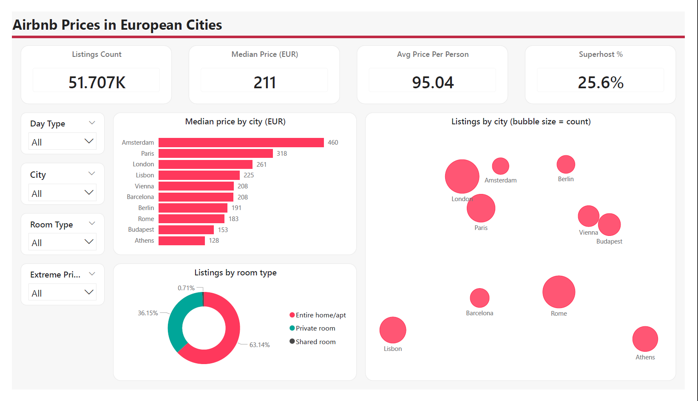
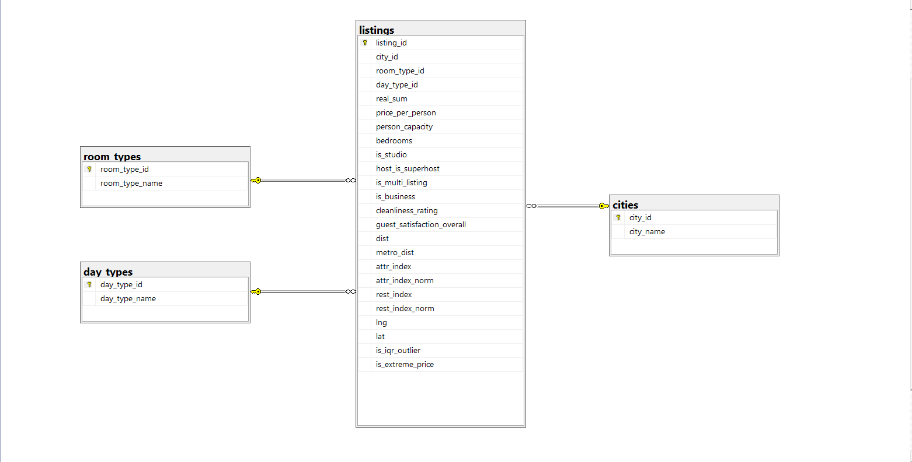

```mermaid
flowchart LR
    A["📁 20 CSV Files<br/>(Bronze)"] --> B["🐍 Notebook 01<br/>Ingestion & Profiling"]
    B --> C["🐍 Notebook 02<br/>Merge & EDA"]
    C --> D["📄 airbnb_merged.csv<br/>(Silver)"]
    D --> E["🐍 Notebook 03<br/>Clean & Export"]
    E --> F["📊 airbnb_clean.xlsx<br/>(Silver)"]
    F --> G["🐍 Notebook 04<br/>Load to SQL Server"]
    G --> H["🗄️ stg_airbnb<br/>(Staging Table)"]
    H --> I["📝 SQL Scripts<br/>Normalize"]
    I --> J["🗄️ Star Schema<br/>(Gold)"]
    J --> K["📊 Power BI<br/>Dashboard"]
```

# 🏠 Airbnb Prices in European Cities

> **End-to-end data engineering & analytics pipeline** — from raw CSVs to a normalized SQL Server database and an interactive Power BI dashboard.



---

## 📋 Table of Contents

- [Overview](#-overview)
- [Dataset](#-dataset)
- [Architecture](#-architecture)
- [Project Structure](#-project-structure)
- [Pipeline Steps](#-pipeline-steps)
  - [Step 1 — Bronze: Ingestion & Profiling](#step-1--bronze-ingestion--profiling)
  - [Step 2 — Silver: Merge & EDA](#step-2--silver-merge--eda)
  - [Step 3 — Silver: Clean & Export](#step-3--silver-clean--export)
  - [Step 4 — Gold: Load to SQL Server](#step-4--gold-load-to-sql-server)
  - [Step 5 — Gold: Normalize (SQL)](#step-5--gold-normalize-sql)
  - [Step 6 — Dashboard (Power BI)](#step-6--dashboard-power-bi)
- [Database Schema](#-database-schema)
- [Key Findings](#-key-findings)
- [Tech Stack](#-tech-stack)
- [Getting Started](#-getting-started)
- [License](#-license)

---

## 🔍 Overview

This project builds a complete **Bronze → Silver → Gold** data pipeline that analyzes Airbnb listing prices across **10 major European cities**. The raw data is ingested, profiled, cleaned, merged, loaded into SQL Server, normalized into a star schema, and finally visualized in an interactive Power BI dashboard.

**Cities covered:** Amsterdam · Athens · Barcelona · Berlin · Budapest · Lisbon · London · Paris · Rome · Vienna

---

## 📊 Dataset

| Detail | Value |
|---|---|
| **Source** | [Airbnb Prices in European Cities (Kaggle)](https://www.kaggle.com/datasets/thedevastator/airbnb-prices-in-european-cities) |
| **Raw files** | 20 CSV files (10 cities × 2 day types: weekdays & weekends) |
| **Total rows** | **51,707** listings |
| **Columns (raw)** | 20 features per file |
| **Columns (cleaned)** | 26 features (after adding derived columns) |

### Raw Columns

| Column | Type | Description |
|---|---|---|
| `realSum` | float | Total price of the listing (EUR) |
| `room_type` | string | Entire home/apt, Private room, or Shared room |
| `room_shared` | bool | Whether the room is shared |
| `room_private` | bool | Whether the room is private |
| `person_capacity` | float | Maximum number of guests |
| `host_is_superhost` | bool | Whether the host is a Superhost |
| `multi` | int | Whether the host has multiple listings (1/0) |
| `biz` | int | Whether the host is a business (1/0) |
| `cleanliness_rating` | float | Cleanliness score (0–10) |
| `guest_satisfaction_overall` | float | Overall guest satisfaction (0–100) |
| `bedrooms` | int | Number of bedrooms |
| `dist` | float | Distance to city center (km) |
| `metro_dist` | float | Distance to nearest metro station (km) |
| `attr_index` | float | Attraction index of the location |
| `attr_index_norm` | float | Normalized attraction index (0–100) |
| `rest_index` | float | Restaurant index of the location |
| `rest_index_norm` | float | Normalized restaurant index (0–100) |
| `lng` | float | Longitude |
| `lat` | float | Latitude |

---

## 🏗 Architecture

The pipeline follows a **Medallion Architecture** with three layers:

```
Bronze (Raw)  ──►  Silver (Cleaned)  ──►  Gold (SQL Server + Dashboard)
```



---

## 📁 Project Structure

```
Airbnb-Prices-in-European-Cities/
│
├── data/
│   ├── bronze/
│   │   ├── csv/                          # 20 raw CSV files (10 cities × 2 day types)
│   │   │   ├── amsterdam_weekdays.csv
│   │   │   ├── amsterdam_weekends.csv
│   │   │   ├── athens_weekdays.csv
│   │   │   ├── ...
│   │   │   └── vienna_weekends.csv
│   │   └── scraped/                      # (reserved for scraped data)
│   │
│   └── silver/
│       ├── airbnb_merged.csv             # Merged dataset (51,707 rows × 21 cols)
│       └── airbnb_clean.xlsx             # Final cleaned dataset (51,707 rows × 26 cols)
│
├── notebooks/
│   ├── 01_bronze_ingestion.ipynb         # File discovery, profiling, schema check
│   ├── 02_silver_merge_eda.ipynb         # Merge, validate, EDA & visualizations
│   ├── 03_silver_clean_export.ipynb      # Standardize, derive cols, flag outliers, export
│   └── 04_gold_load_staging.ipynb        # Load cleaned data into SQL Server staging table
│
├── sql/
│   ├── 01_create_staging.sql             # Create database & staging table
│   ├── 02_create_schema.sql              # Create dimension + fact tables (star schema)
│   ├── 03_insert_data.sql                # Populate dimension & fact tables from staging
│   ├── 04_validate.sql                   # Validation queries (row counts, orphan check)
│   └── schema_diagram.png               # ER diagram of the Gold schema
│
├── dashboard/
│   ├── airbnb_dashboard.pbix             # Power BI dashboard file
│   └── screenshots/
│       └── page1_overview.png            # Dashboard screenshot
│
├── .gitignore
├── LICENSE                               # MIT License
├── requirements.txt
└── README.md
```

---

## 🔧 Pipeline Steps

### Step 1 — Bronze: Ingestion & Profiling

📓 **Notebook:** [`01_bronze_ingestion.ipynb`](notebooks/01_bronze_ingestion.ipynb)

This notebook discovers and profiles the 20 raw CSV files in `data/bronze/csv/`.

**What it does:**
1. **File Discovery** — Scans the bronze folder and lists all 20 CSV files
2. **File-Level Summary** — For each file, records: rows, columns, total nulls, and duplicate count
3. **Schema Consistency Check** — Compares column names across all files to ensure they can be merged safely
4. **Sample Inspection** — Shows the first rows, data types, and basic statistics of a sample file
5. **Hidden Missing Values Check** — Counts zeros per column across all files to distinguish valid zeros (binary flags, studios) from suspicious ones

**Key findings:**
- ✅ All 20 files share the **same 20 columns** — safe to merge
- ✅ **Zero nulls** and **zero duplicates** across all files
- ✅ Total of **51,707 rows** across all files

| City | Weekday Rows | Weekend Rows |
|---|---|---|
| Amsterdam | 1,103 | 977 |
| Athens | 2,653 | 2,627 |
| Barcelona | 1,555 | 1,278 |
| Berlin | 1,284 | 1,200 |
| Budapest | 2,074 | 1,948 |
| Lisbon | 2,857 | 2,906 |
| London | 4,614 | 5,379 |
| Paris | 3,130 | 3,558 |
| Rome | 4,492 | 4,535 |
| Vienna | 1,738 | 1,799 |

---

### Step 2 — Silver: Merge & EDA

📓 **Notebook:** [`02_silver_merge_eda.ipynb`](notebooks/02_silver_merge_eda.ipynb)

Merges all 20 files into a single master dataset and performs exploratory data analysis.

**What it does:**
1. **Setup** — Asks for bronze and silver folder paths; creates the silver folder if needed
2. **Load, Tag, and Append** — Reads each CSV, extracts `city` and `day_type` from the filename pattern `{city}_{weekdays|weekends}.csv`, drops the leftover `Unnamed: 0` index column, and appends all frames
3. **Validation** — Verifies row count matches (expected: 51,707 = actual: 51,707), checks all city/day_type combinations are present, and confirms zero duplicates and nulls
4. **Save** — Exports the merged dataset to `data/silver/airbnb_merged.csv`
5. **Price Distribution & Outliers** — Analyzes the target column `realSum`:
   - Prices range from **€34.78** to **€18,545.45** with a skewness of **21.42**
   - IQR-based outlier detection per city (3–8% per city)
6. **Correlation Analysis** — Pearson and Spearman correlations with price:
   - Top correlated features: `attr_index_norm` (Spearman: 0.494), `attr_index` (0.385), `lat` (0.357)
   - Weak/no correlation: `cleanliness_rating` (0.005), `guest_satisfaction_overall` (0.014)

**Outlier summary per city:**

| City | Median Price (€) | Max Price (€) | IQR Upper Bound | Outliers | Outliers % |
|---|---|---|---|---|---|
| Amsterdam | 460.2 | 8,130.7 | 1,218.4 | 105 | 5.05% |
| Athens | 127.7 | 18,545.5 | 280.9 | 293 | 5.55% |
| Barcelona | 208.3 | 6,943.7 | 583.2 | 227 | 8.01% |
| Berlin | 191.2 | 5,857.5 | 478.5 | 165 | 6.64% |
| Budapest | 153.0 | 3,751.2 | 308.0 | 223 | 5.54% |
| Lisbon | 225.4 | 1,681.1 | 475.6 | 192 | 3.33% |
| London | 261.3 | 15,499.9 | 841.0 | 531 | 5.31% |
| Paris | 317.6 | 16,445.6 | 793.8 | 386 | 5.77% |
| Rome | 182.6 | 2,418.3 | 394.4 | 433 | 4.80% |
| Vienna | 208.5 | 13,664.3 | 440.0 | 151 | 4.27% |

---

### Step 3 — Silver: Clean & Export

📓 **Notebook:** [`03_silver_clean_export.ipynb`](notebooks/03_silver_clean_export.ipynb)

Standardizes the merged dataset, adds derived columns, flags outliers, and exports to Excel.

**What it does:**
1. **Load** — Reads `airbnb_merged.csv` from the Silver layer
2. **Standardize Columns & Data Types** — Renames `realSum` → `real_sum`, trims whitespace in text columns, casts `person_capacity` and `bedrooms` to integers
3. **Derived Columns:**
   - `is_studio` — Entire home/apt with zero bedrooms (**4,026 studios** identified)
   - `price_per_person` — Total price divided by person capacity
4. **Outlier Flags:**
   - `is_iqr_outlier` — Price above Q3 + 1.5×IQR within its own city (**2,706 outliers**)
   - `is_extreme_price` — Price above a configurable threshold (default €5,000; **26 extreme listings**)
   - User can choose to **flag** (default) or **remove** extreme prices
5. **Surrogate Key** — Creates `listing_id` (1 to 51,707) as the primary key
6. **Validation** — Final checks: zero nulls, zero duplicate IDs, valid value ranges, 10 cities, 2 day types, 3 room types
7. **Export** — Saves the cleaned dataset to `data/silver/airbnb_clean.xlsx` (51,707 rows × 26 columns)

**Final schema (26 columns):**

| Column | Type | Description |
|---|---|---|
| `listing_id` | int | Surrogate primary key (1–51,707) |
| `real_sum` | float | Total price (EUR) |
| `room_type` | string | Entire home/apt, Private room, Shared room |
| `room_shared` | bool | Shared room flag |
| `room_private` | bool | Private room flag |
| `person_capacity` | int | Max guests |
| `host_is_superhost` | bool | Superhost status |
| `multi` | int | Multi-listing host flag |
| `biz` | int | Business host flag |
| `cleanliness_rating` | float | Cleanliness score |
| `guest_satisfaction_overall` | float | Guest satisfaction score |
| `bedrooms` | int | Number of bedrooms |
| `dist` | float | Distance to city center (km) |
| `metro_dist` | float | Distance to metro (km) |
| `attr_index` / `attr_index_norm` | float | Attraction index (raw / normalized) |
| `rest_index` / `rest_index_norm` | float | Restaurant index (raw / normalized) |
| `lng` / `lat` | float | Coordinates |
| `city` | string | City name |
| `day_type` | string | weekday / weekend |
| `is_studio` | bool | Studio apartment flag |
| `price_per_person` | float | Price per guest |
| `is_iqr_outlier` | bool | IQR outlier flag |
| `is_extreme_price` | bool | Extreme price flag |

---

### Step 4 — Gold: Load to SQL Server

📓 **Notebook:** [`04_gold_load_staging.ipynb`](notebooks/04_gold_load_staging.ipynb)

Loads the cleaned Silver Excel file into a SQL Server staging table.

**What it does:**
1. **Connection Settings** — Prompts for SQL Server name, database name (`AirbnbEurope`), and ODBC driver. Uses **Windows Authentication**
2. **Read Silver File** — Loads `airbnb_clean.xlsx` (51,707 rows × 26 columns)
3. **Load to Staging** — Truncates `stg_airbnb` first (safe to re-run), then inserts data in chunks of 5,000 rows using SQLAlchemy with `fast_executemany=True`
4. **Verify** — Confirms row count in SQL matches the file (51,707 = 51,707 ✅)

---

### Step 5 — Gold: Normalize (SQL)

📝 **SQL Scripts:** [`sql/`](sql/)

Four sequential SQL scripts transform the flat staging table into a normalized star schema.

| Script | Purpose |
|---|---|
| [`01_create_staging.sql`](sql/01_create_staging.sql) | Creates the `AirbnbEurope` database and the `stg_airbnb` staging table |
| [`02_create_schema.sql`](sql/02_create_schema.sql) | Creates 3 dimension tables (`cities`, `room_types`, `day_types`) and 1 fact table (`listings`) with foreign keys |
| [`03_insert_data.sql`](sql/03_insert_data.sql) | Populates dimension tables with `DISTINCT` values, then fills the fact table by joining staging data to dimension keys |
| [`04_validate.sql`](sql/04_validate.sql) | Validates: row counts match (51,707), no orphan rows, and sanity-checks average price by city |

---

### Step 6 — Dashboard (Power BI)

📊 **File:** [`dashboard/airbnb_dashboard.pbix`](dashboard/airbnb_dashboard.pbix)

An interactive Power BI dashboard connected to the Gold SQL Server database.

**Dashboard Screenshot:**


**Dashboard KPIs:**
- **Listings Count:** 51.707K
- **Median Price:** €211
- **Avg Price Per Person:** €95.04
- **Superhost %:** 25.6%

**Interactive Filters:**
- Day Type (weekday / weekend)
- City
- Room Type
- Extreme Price flag

**Visualizations:**
- 📊 Median price by city (horizontal bar chart)
- 🫧 Listings by city (bubble chart — size = count)
- 🍩 Listings by room type (donut chart: 63.14% Entire home/apt, 36.15% Private room, 0.71% Shared room)

---

## 🗄 Database Schema

The Gold layer uses a **star schema** with 3 dimension tables and 1 fact table:



### Dimension Tables

**`cities`** — 10 rows
| Column | Type | Description |
|---|---|---|
| `city_id` | INT (PK, IDENTITY) | Auto-increment ID |
| `city_name` | NVARCHAR(30) | City name (unique) |

**`room_types`** — 3 rows
| Column | Type | Description |
|---|---|---|
| `room_type_id` | INT (PK, IDENTITY) | Auto-increment ID |
| `room_type_name` | NVARCHAR(30) | Room type (unique) |

**`day_types`** — 2 rows
| Column | Type | Description |
|---|---|---|
| `day_type_id` | INT (PK, IDENTITY) | Auto-increment ID |
| `day_type_name` | NVARCHAR(10) | weekday / weekend (unique) |

### Fact Table

**`listings`** — 51,707 rows
| Column | Type | Constraint |
|---|---|---|
| `listing_id` | INT | PRIMARY KEY |
| `city_id` | INT | FK → `cities` |
| `room_type_id` | INT | FK → `room_types` |
| `day_type_id` | INT | FK → `day_types` |
| `real_sum` | DECIMAL(12,4) | NOT NULL |
| `price_per_person` | DECIMAL(12,4) | NOT NULL |
| `person_capacity` | INT | NOT NULL |
| `bedrooms` | INT | NOT NULL |
| `is_studio` | BIT | NOT NULL |
| `host_is_superhost` | BIT | NOT NULL |
| `is_multi_listing` | BIT | NOT NULL |
| `is_business` | BIT | NOT NULL |
| `cleanliness_rating` | DECIMAL(4,1) | NOT NULL |
| `guest_satisfaction_overall` | DECIMAL(5,1) | NOT NULL |
| `dist` | DECIMAL(10,6) | NOT NULL |
| `metro_dist` | DECIMAL(10,6) | NOT NULL |
| `attr_index` | DECIMAL(12,6) | NOT NULL |
| `attr_index_norm` | DECIMAL(12,6) | NOT NULL |
| `rest_index` | DECIMAL(12,6) | NOT NULL |
| `rest_index_norm` | DECIMAL(12,6) | NOT NULL |
| `lng` | DECIMAL(9,6) | NOT NULL |
| `lat` | DECIMAL(9,6) | NOT NULL |
| `is_iqr_outlier` | BIT | NOT NULL |
| `is_extreme_price` | BIT | NOT NULL |

---

## 💡 Key Findings

1. **Amsterdam is the most expensive city** with a median price of **€460**, nearly 3.6× Athens (€128)
2. **63% of listings are "Entire home/apt"**, 36% Private rooms, and less than 1% Shared rooms
3. **25.6% of hosts are Superhosts** across all cities
4. **Price is highly right-skewed** (skewness = 21.42), with outliers ranging up to €18,545
5. **Location matters most** — the strongest price correlations are with `attr_index_norm` (Spearman: 0.494), followed by `attr_index` (0.385) and latitude (0.357)
6. **Satisfaction & cleanliness have almost no correlation with price** (Spearman < 0.015)
7. **Barcelona has the highest outlier percentage** (8.01%), while **Lisbon has the lowest** (3.33%)

---

## 🛠 Tech Stack

| Layer | Technology |
|---|---|
| **Language** | Python 3.11 |
| **Data Processing** | Pandas, NumPy |
| **Visualization** | Matplotlib |
| **Database** | Microsoft SQL Server |
| **Python ↔ SQL** | SQLAlchemy + pyodbc |
| **Dashboard** | Power BI |
| **Notebooks** | Jupyter |
| **Version Control** | Git / GitHub |

---

## 🚀 Getting Started

### Prerequisites

- Python 3.11+
- Microsoft SQL Server (or SQL Server Express)
- ODBC Driver 17 for SQL Server
- Power BI Desktop (to open the `.pbix` file)

### Installation

```bash
# 1. Clone the repository
git clone https://github.com/Ahmed-Tarek0/Airbnb-Prices-in-European-Cities.git
cd Airbnb-Prices-in-European-Cities

# 2. Create a virtual environment
python -m venv .venv
.venv\Scripts\activate        # Windows
# source .venv/bin/activate   # macOS/Linux

# 3. Install dependencies
pip install pandas numpy matplotlib sqlalchemy pyodbc openpyxl
```

### Running the Pipeline

1. **Run notebooks in order** (01 → 02 → 03 → 04):
   ```
   notebooks/01_bronze_ingestion.ipynb
   notebooks/02_silver_merge_eda.ipynb
   notebooks/03_silver_clean_export.ipynb
   notebooks/04_gold_load_staging.ipynb
   ```

2. **Run SQL scripts in order** on SQL Server:
   ```
   sql/01_create_staging.sql
   sql/02_create_schema.sql
   sql/03_insert_data.sql
   sql/04_validate.sql
   ```

3. **Open the dashboard** in Power BI Desktop:
   ```
   dashboard/airbnb_dashboard.pbix
   ```
   > Update the data source connection to point to your SQL Server instance.

---

## 📝 License

This project is licensed under the **MIT License** — see the [LICENSE](LICENSE) file for details.

**Copyright © 2026 Ahmed-Tarek0**
